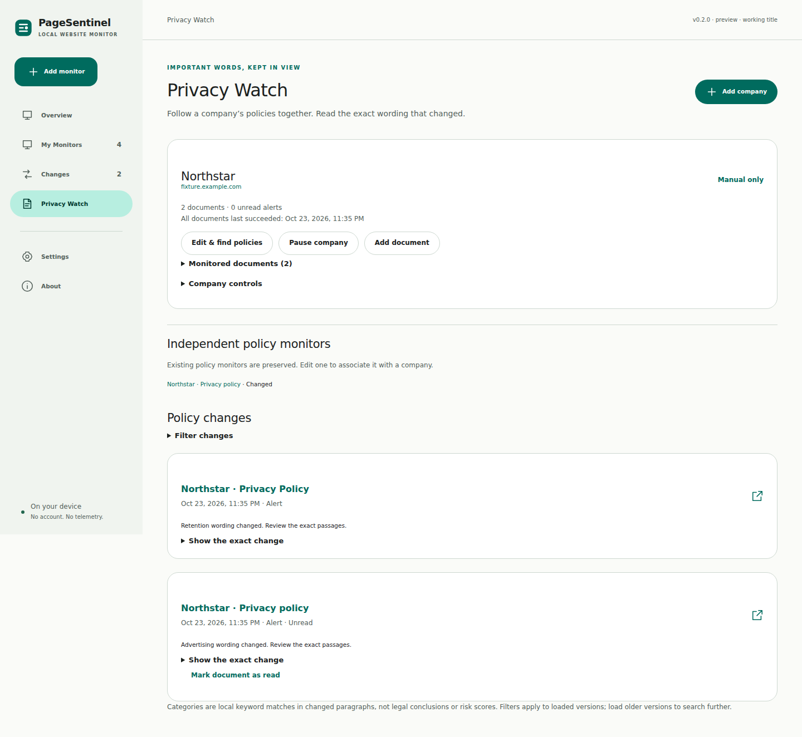

# PageSentinel

Local website monitoring for Chrome. Follow a page, a price or a company's policies. Review the actual wording that changed, and see when a monitor needs attention.

Free software under GPL-3.0-or-later. No accounts, subscriptions, ads, telemetry, or developer backend.



Screenshots show the actual built extension with controlled synthetic product and policy pages.

**Working title:** an unrelated commercial website monitor also uses PageSentinel. This project is not affiliated with it. The name is provisional; no Chrome Web Store listing has been submitted.

## Install

The published release is still v0.1.0. The v0.2.0 preview described below is developed in reviewable pull requests; successful CI artifacts provide its installable ZIP. Build a source checkout with the commands below. Update the same installed extension/profile to preserve its storage; another extension ID creates separate storage. Back up before upgrading.

1. Download `pagesentinel-0.1.0.zip` from [Releases](https://github.com/librerob/pagesentinel/releases).
2. Extract the ZIP into a folder you intend to keep.
3. In Chrome 120 or newer, open `chrome://extensions` and enable **Developer mode**.
4. Choose **Load unpacked** and select the extracted folder containing `manifest.json`.
5. Pin the toolbar icon. Open a public website and choose **Monitor this page**, or **Select an element**.

Allow access to the selected website when Chrome asks. The first background check establishes a verified baseline; a failed first check is shown as needing attention. It never pretends that monitoring succeeded.

## What works in the v0.2.0 preview

- Overview introduces Monitor a Website, Privacy Watch and My Monitors. Skippable onboarding persists across restarts; technical controls stay in contextual advanced sections.
- Privacy Watch company profiles group confirmed policy documents, shared schedules, individual overrides, regional labels and monitoring health. Removing a company preserves its documents/history.
- Find actual policy links in English, Norwegian, Spanish, German and French. Review candidates and authorize every selected origin; no invented URLs or silent crawling.
- Paginated cross-monitor timelines, inline/before/after/side-by-side views, exact policy evidence and conservative keyword categories. Paragraph reordering is distinguished from changed wording.
- Guided selector repair, atomic bulk management, notification snoozing, website-grant removal and optional passphrase-encrypted backup files.
- Stable-link new-item detection ignores ordering/label changes. Complete-message availability matching rejects negated/ambiguous states; generic keyword mode remains available.

- Full-page public HTML text and a uniquely selected element.
- Selected sections can be monitored beside unrelated login modals; sign-in titles, challenges, and password fields inside the selection still fail visibly.
- One-action full-page creation from the toolbar, with origin-specific permission.
- Temporary visual picker with hover highlight, parent selection, preview, and Escape to cancel.
- Persisted schedules using Chrome alarms; manual checks, pause/resume, retry backoff, interrupted-check recovery, and overdue health.
- Exact text comparisons, local version history, unread changes, and native notification requests.
- Dedicated policy monitors, before/after text, and relevant changed-paragraph keyword highlights.
- Price decreases, increases, new lows, and threshold crossings. Ambiguous numeric formats fail visibly.
- Price labels include NOK, SEK, DKK, PLN, CZK, INR, BRL, MXN, NZD, SGD, HKD, KRW, CNY and bare `kr`/`kr.`; labelled prices can use the trailing `,-` zero-decimal convention.
- Case-insensitive phrase appearance, disappearance, or count changes, including availability phrases.
- Optional exclusions, exact ignored phrases, ISO timestamp suppression, numeric suppression, and text-change thresholds.
- Text and policy thresholds accumulate edits against the last alert (or initial baseline); small successive edits no longer disappear through baseline drift.
- Material Design 3 semantic themes: System, Light, Dark, and true-black AMOLED; six accent choices. Roboto is bundled locally.
- Bounded local history, JSON export including history, and validated configuration import as paused copies.
- Version 2 storage separates baseline/reference text from lightweight metadata. Scheduled ticks and badge updates avoid reading every monitor's text; successful checks account only for the selected monitor and its retained versions.

## How checks work

The service worker fetches the approved public URL without credentials and parses its HTML with a bundled inert parser. Scripts, embedded documents, and hidden attributes are excluded. Normalized text is hashed and compared with the last successful baseline. Every distinct successful text version is recorded; alert rules determine unread counts and notifications. A successful check updates the baseline even if its alert rule does not trigger.

Failed checks retain the previous baseline. The dashboard shows last attempt, last success, expected next check, failures, permission state, and actionable explanations. The toolbar badge shows `!` when attention is needed. Browser and OS notification settings may suppress alerts, so the dashboard is the source of truth.

Checks run while Chrome is active. Chrome can delay alarms during sleep or load. This is not a guaranteed 24/7 service. The scheduler processes up to three due monitors per minute, one at a time; large watchlists or short intervals will become overdue visibly. There is no fixed total monitor-count cap. Resource budgets are safety controls, not paid tiers: 2 MiB per HTML response, 120,000 extracted characters, 18-second fetch timeout, 10–200 versions per monitor, and 50 MiB of logical monitoring data. Discovery, bulk actions and list extraction also have per-action processing bounds.

## Privacy and permissions

Host access is optional and requested per selected origin. No broad mandatory website access, cookies API, browser history API, analytics, cloud sync, or remote executable code is used. Monitoring data is kept in local IndexedDB; preferences and onboarding use `chrome.storage.local`. Session storage temporarily holds selection, repair and discovery context. Normal storage is plaintext. Optional backup encryption uses native AES-256-GCM with passphrase-derived keys; the passphrase is never saved. Plain JSON export remains available with a warning. Chrome grants cover paths and may cover ports beyond a saved URL.

Monitored websites receive ordinary requests from your network address. No monitoring data is sent to a developer-controlled backend. Checks omit credentials and referrers, reject embedded URL credentials and redirects, and do not reproduce a signed-in session. See [PRIVACY.md](PRIVACY.md) and [SECURITY.md](SECURITY.md).

## Boundaries

The 50 MiB limit measures logical UTF-8 monitor/history records, not physical IndexedDB/index overhead. Version 1 data migrates in one transaction without dropping history. If adding missing alert references puts an existing profile over budget, checks report a storage error until you export and clear history, reset unused baselines, or remove unused monitors. The migration uses the latest retained alert/initial version for missing references, falling back to the current baseline when that history is unavailable.

Prices require exactly one explicit currency label. Bare `kr` is kept as `kr`, not guessed as NOK/SEK/DKK. A bare amount such as `1.299,-` still fails because it has no currency; `kr 1.299,-` is supported. Ambiguous decimal/thousands separators require an explicit decimal choice.

Redirects remain rejected by design to prevent unapproved-host contact, including private addresses. Open a redirecting URL in your browser, then paste its final address or use **Monitor this page** / **Select an element** from the final page. Both setup flows save Chrome's current final tab URL.

Dynamic JavaScript rendering, authenticated monitoring, screenshots, PDFs, automation macros, XPath, arbitrary regular expressions and automatic selector substitution are not implemented. Selection succeeds only if the corresponding unique element exists in public HTML. CSS-hidden content cannot always be recognized without rendering; choose the specific section when needed. A unique main/article landmark narrows policy extraction, otherwise the whole-page fallback is retained. Keyword categories identify potentially relevant changed passages, not legal conclusions or risk scores. Regional variants require distinct source URLs.

Import restores monitor/company configurations with fresh IDs as paused copies and requires origin access before resuming. Current appearance settings remain unchanged. Exported historical text stays archival in the backup; it is not imported into the live timeline or trusted as a baseline. Encrypted/decrypted content is bounded at 64 MiB; encrypted file input allows 90 MiB for base64 overhead. Lost passphrases cannot be recovered. Normal local storage remains plaintext.

Availability requires an exact complete stock message. New-item monitoring requires stable, unique public link URLs; empty or ambiguous lists fail visibly. Changing link query parameters can look like a new entry. Timeline filters apply to loaded versions; load older versions to search further. Automated accessibility checks and expert review do not establish full WCAG compliance or superiority over competitors.

## Development

Use Node.js 24 and npm:

```sh
npm ci --ignore-scripts
npm run typecheck
npm run lint
npm run format:check
npm test
npm run build
npm run validate
npx playwright install --with-deps chromium
npm run test:browser
npm run package
```

Load `dist/` unpacked after building. The release ZIP is written to `artifacts/`. Build tools use supported WebAssembly packages so the build also works where native build binaries are blocked. `npm run dev` previews the UI; monitoring requires the built Chrome extension.

Browser tests use controlled synthetic pages, a temporary extension copy with one test host pre-granted, and a fresh profile. The shipping manifest has no mandatory host access. Set `CHROMIUM_PATH` to a Chrome for Testing executable if needed. Native permission prompts and OS notification presentation need supervised checks. See [validation](docs/VALIDATION.md), [architecture](docs/ARCHITECTURE.md), [research](docs/RESEARCH.md), and [contribution guidance](CONTRIBUTING.md).

## Preview evidence and next work

See [Privacy Watch](docs/PRIVACY_WATCH.md), [backup and monitoring controls](docs/BACKUPS_AND_MONITORING.md), [migration](docs/MIGRATION_V3.md), [security review](docs/SECURITY_REVIEW.md), [public-page sample](docs/COMPATIBILITY.md), [usability review and participant plan](docs/USABILITY.md), and [rendered-mode investigation](docs/DYNAMIC_MONITORING.md). Public-site sampling uses the production core in Node; it is not Chrome compatibility certification. Screenshots and Chromium scenarios use the actual built extension with controlled fixtures. Native permission dialogs, OS notifications, assistive technology and real-user usability still need supervised checks. This remains a preview; no store submission or production-readiness claim is made.
