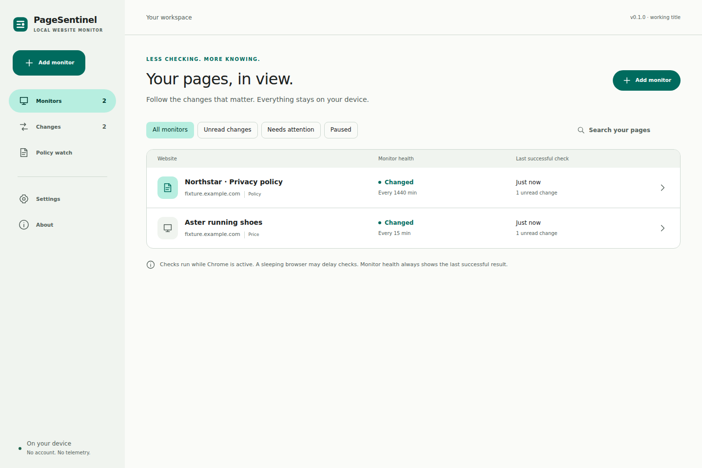

# PageSentinel

Local website monitoring for Chrome. Follow a page or select a price, paragraph, or announcement. Review the actual wording that changed, and see when a monitor needs attention.

Free software under GPL-3.0-or-later. No accounts, subscriptions, ads, telemetry, or developer backend.



Screenshots show the actual built extension with controlled synthetic product and policy pages.

**Working title:** an unrelated commercial website monitor also uses PageSentinel. This project is not affiliated with it. The name is provisional; no Chrome Web Store listing has been submitted.

## Install

1. Download `pagesentinel-0.1.0.zip` from [Releases](https://github.com/librerob/pagesentinel/releases).
2. Extract the ZIP into a folder you intend to keep.
3. In Chrome 120 or newer, open `chrome://extensions` and enable **Developer mode**.
4. Choose **Load unpacked** and select the extracted folder containing `manifest.json`.
5. Pin the toolbar icon. Open a public website and choose **Monitor this page**, or **Select an element**.

Allow access to the selected website when Chrome asks. The first background check establishes a verified baseline; a failed first check is shown as needing attention. It never pretends that monitoring succeeded.

## What works in v0.1.0

- Full-page public HTML text and a uniquely selected element.
- Selected sections can be monitored beside unrelated login modals; sign-in titles, challenges, and password fields inside the selection still fail visibly.
- One-action full-page creation from the toolbar, with origin-specific permission.
- Temporary visual picker with hover highlight, parent selection, preview, and Escape to cancel.
- Persisted schedules using Chrome alarms; manual checks, pause/resume, retry backoff, interrupted-check recovery, and overdue health.
- Exact text comparisons, local version history, unread changes, and native notification requests.
- Dedicated policy monitors, before/after text, and relevant changed-paragraph keyword highlights.
- Price decreases, increases, new lows, and threshold crossings. Ambiguous numeric formats fail visibly.
- Case-insensitive phrase appearance, disappearance, or count changes, including availability phrases.
- Optional exclusions, exact ignored phrases, ISO timestamp suppression, numeric suppression, and text-change thresholds.
- Text and policy thresholds accumulate edits against the last alert (or initial baseline); small successive edits no longer disappear through baseline drift.
- Material Design 3 semantic themes: System, Light, Dark, and true-black AMOLED; six accent choices. Roboto is bundled locally.
- Bounded local history, JSON export including history, and validated configuration import as paused copies.

## How checks work

The service worker fetches the approved public URL without credentials and parses its HTML with a bundled inert parser. Scripts, embedded documents, and hidden attributes are excluded. Normalized text is hashed and compared with the last successful baseline. Every distinct successful text version is recorded; alert rules determine unread counts and notifications. A successful check updates the baseline even if its alert rule does not trigger.

Failed checks retain the previous baseline. The dashboard shows last attempt, last success, expected next check, failures, permission state, and actionable explanations. The toolbar badge shows `!` when attention is needed. Browser and OS notification settings may suppress alerts, so the dashboard is the source of truth.

Checks run while Chrome is active. Chrome can delay alarms during sleep or load. This is not a guaranteed 24/7 service. The scheduler processes up to three due monitors per minute, one at a time; large watchlists or short intervals will become overdue visibly. Resource budgets are safety controls, not paid tiers: 500 configurations per profile, 2 MiB per HTML response, 120,000 extracted characters, 18-second fetch timeout, 10–200 versions per monitor, and 50 MiB of monitoring data.

## Privacy and permissions

Host access is optional and requested per selected origin. No broad mandatory website access, cookies API, browser history API, analytics, cloud sync, or remote executable code is used. Monitoring data is kept in local IndexedDB; small preferences use `chrome.storage.local`. It is not encrypted by the extension. Exported JSON is also plain text.

Monitored websites receive ordinary requests from your network address. No monitoring data is sent to a developer-controlled backend. Checks omit credentials and referrers, reject embedded URL credentials and redirects, and do not reproduce a signed-in session. See [PRIVACY.md](PRIVACY.md) and [SECURITY.md](SECURITY.md).

## Boundaries

Redirects remain rejected by design to prevent unapproved-host contact, including private addresses. Open a redirecting URL in your browser, then paste its final address or use **Monitor this page** / **Select an element** from the final page. Both setup flows save Chrome's current final tab URL.

Dynamic JavaScript rendering, authenticated monitoring, screenshots, PDFs, automation macros, selector recovery, company groups, unified Privacy Watch timelines, and encrypted backups are deferred. Selection succeeds only if the corresponding unique element exists in public HTML. CSS-hidden content cannot always be recognized without rendering; choose the specific section when needed. Keyword highlights identify potentially relevant passages, not legal conclusions. Reordered paragraphs are presented as removals/additions.

Import restores configurations as paused copies and requires origin access before resuming. Exported historical text stays in the backup for archival use; it is not imported as a trusted live baseline. Labels and arbitrary regular expressions are not implemented.

## Development

Use Node.js 24 and npm:

```sh
npm ci --ignore-scripts
npm run typecheck
npm run lint
npm run format:check
npm test
npm run build
npm run validate
npx playwright install --with-deps chromium
npm run test:browser
npm run package
```

Load `dist/` unpacked after building. The release ZIP is written to `artifacts/`. Build tools use supported WebAssembly packages so the build also works where native build binaries are blocked. `npm run dev` previews the UI; monitoring requires the built Chrome extension.

Browser tests use controlled synthetic pages, a temporary extension copy with one test host pre-granted, and a fresh profile. The shipping manifest has no mandatory host access. Set `CHROMIUM_PATH` to a Chrome for Testing executable if needed. Native permission prompts and OS notification presentation need supervised checks. See [validation](docs/VALIDATION.md), [architecture](docs/ARCHITECTURE.md), [research](docs/RESEARCH.md), and [contribution guidance](CONTRIBUTING.md).

## Next: v0.2.0

Start with supervised daily-use reliability and permission testing. Then add Privacy Watch company groups and a shared timeline for multiple confirmed policy documents. Optional dynamic rendering should remain a separately permissioned, tested mode.
